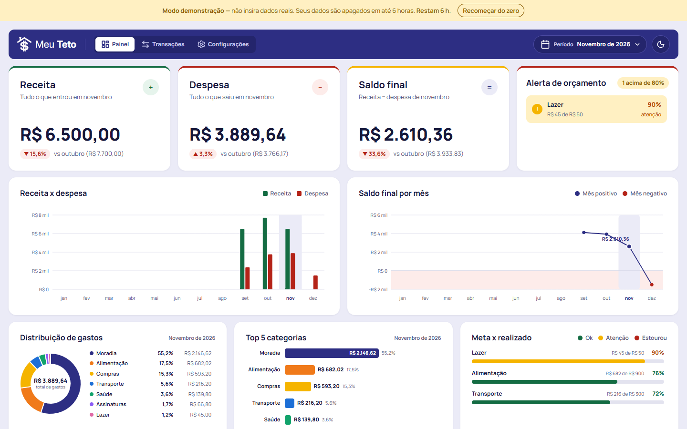
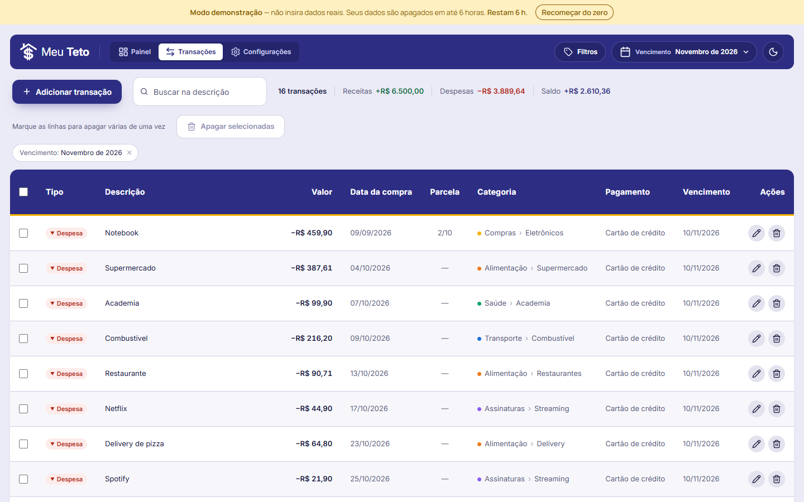
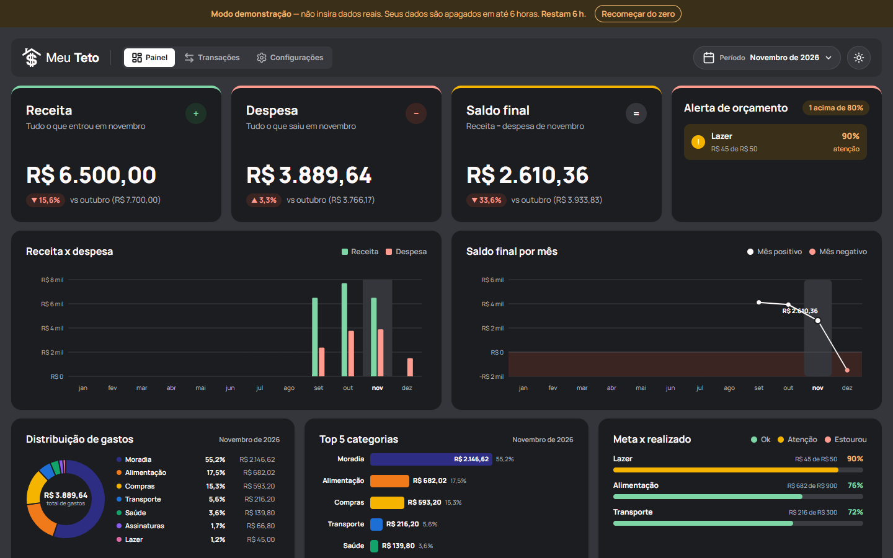
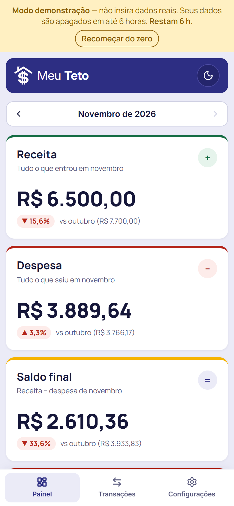

# Meu Teto

[](https://github.com/isabelavmagella/meuTeto/actions/workflows/ci.yml)
[](LICENSE)

Controle financeiro pessoal para entender para onde vai o dinheiro, mês a mês.
Lança receitas e despesas (inclusive parceladas no cartão, com o vencimento de
cada fatura calculado), organiza tudo em categorias e subcategorias, acompanha
orçamentos e gera sozinho os lançamentos recorrentes, como aluguel e
assinaturas.

<!-- Link da demo: adicionar aqui depois do deploy na Vercel. -->
**Experimente:** a versão publicada não pede cadastro. Clique em
**"Experimentar o app"** e você recebe uma conta temporária com dados de exemplo
dos últimos 3 meses.



<table>
  <tr>
    <td></td>
    <td></td>
  </tr>
  <tr>
    <td colspan="2" align="center"></td>
  </tr>
</table>

## Funcionalidades

- **Dashboard mensal:** receita, despesa e saldo com comparação com o mês
  anterior, histórico do ano, distribuição de gastos por categoria (com
  drill-down por subcategoria) e alerta de orçamentos acima de 80%.
- **Transações:** compras parceladas, cartão com dia de fechamento e de
  vencimento, busca na descrição sem diferenciar acentos, filtros por
  vencimento, data da compra, categoria, subcategoria e forma de pagamento, e
  exclusão em lote.
- **Recorrências:** aluguel, salário, assinaturas… lançados automaticamente
  todo mês.
- **Configurações:** categorias com cor, subcategorias, formas de pagamento e
  orçamentos mensais.
- Tema claro/escuro, layout responsivo e modo demonstração isolado por
  visitante.

## Stack

| Camada | Tecnologias |
| --- | --- |
| Front-end | React 19, TypeScript, Vite, React Router, React Hook Form + Zod, Recharts, CSS Modules |
| Back-end | Node 22, Express 5, TypeScript, Prisma 7 (driver adapter `pg`), JWT, bcrypt, helmet |
| Banco | PostgreSQL 16 (funções PL/pgSQL, `unaccent`, índices parciais) |
| Testes e CI | Vitest + Supertest (integração contra Postgres real), GitHub Actions |
| Produção | Vercel (front estático + API como Vercel Function) e Neon (Postgres serverless) |

## Decisões técnicas

- **Isolamento por usuário garantido pelo banco.** Categorias, subcategorias,
  formas de pagamento e recorrências têm chave única `(id, userId)`, e as
  transações referenciam essas tabelas por FKs **compostas**
  `(categoryId, userId)`. Mesmo que uma rota esquecesse de filtrar, o banco não
  deixaria uma transação apontar para a categoria de outro usuário. Toda rota
  também filtra pelo usuário do token, inclusive nas operações em lote.
- **Dinheiro sem ponto flutuante.** Os valores são `Decimal(12,2)` no banco,
  validados na entrada (no máximo 2 casas e dentro do limite da coluna), e todas
  as somas são feitas em **centavos inteiros**. Em float, 65,37 + 73,29 + 11,34
  dá 150.00000000000003, o que faria um orçamento de R$ 150,00 "estourar".
- **Datas sem surpresa de fuso.** Datas de compra e vencimento são gravadas como
  meia-noite UTC do dia escolhido e só aceitas no formato `AAAA-MM-DD`. O "hoje"
  e o mês corrente seguem `America/Sao_Paulo`.
- **Vencimento do cartão.** A regra (primeiro fechamento depois da compra;
  vence no mesmo mês se o dia de vencimento vier depois do fechamento, senão no
  seguinte; dia 31 cai no último dia dos meses curtos) existe em TypeScript, para
  as transações, e em PL/pgSQL, para as recorrências. Um teste compara as duas
  em cerca de 10 mil combinações de datas.
- **Recorrências idempotentes, sem job diário.** A função SQL
  `gerar_transacoes_recorrentes` lança os meses que faltam até o mês atual.
  Ela nunca gera meses anteriores à criação da recorrência, guarda a última
  competência processada (uma transação gerada que você apagou não volta) e tem
  `UNIQUE (recorrenciaId, competencia)` como segunda proteção contra duplicar.
  Como é barata, o app a chama a cada carregamento, só para o usuário logado,
  o que dispensa cron em produção.
- **Arquivar em vez de apagar.** Categorias e formas de pagamento são
  arquivadas para não quebrar o histórico. A cor da categoria é única por
  **índice parcial** (`WHERE ativo`), então arquivar uma categoria libera a cor
  dela.
- **Modo demo seguro em serverless.** O rate limit por IP e o teto de demos
  ativos ficam no Postgres (contadores em memória não funcionam com várias
  instâncias) e são verificados sob um *advisory lock*, para cliques simultâneos
  não furarem o limite. O banco guarda só o HMAC do IP.
- **Prisma em serverless.** Um único pool pequeno por instância, liberado antes
  da suspensão da Function (`attachDatabasePool`), usando a URL com pooler do
  Neon. As migrations usam a conexão direta.

## Estrutura

```
back/
  prisma/            schema e migrations (incluindo as funções SQL)
  src/
    routes/          rotas da API, uma por recurso
    middlewares/     autenticação e limites do modo demo
    demo/            criação dos dados de exemplo e limpeza
    utils/           datas, dinheiro, validação, recorrências
    app.ts           app Express (entrada na Vercel)
    server.ts        sobe a porta localmente
  test/              testes de integração e de regras
front/
  src/
    pages/           Dashboard, Transações, Configurações, Início, Login
    components/      componentes por área (Dashboard, Transactions, Settings…)
    contexts/        sessão (login e modo demo)
    lib/api.ts       cliente da API
docs/screenshots/    imagens deste README
```

## Rodando localmente

Requisitos: Node 22+ e Docker.

```bash
git clone https://github.com/isabelavmagella/meuTeto.git
cd meuTeto
docker compose up -d              # Postgres em localhost:5433

cd back
cp .env.example .env              # já aponta para o Postgres do docker-compose
npm install                       # também roda o prisma generate
npx prisma migrate dev            # cria as tabelas e as funções SQL
npm run dev                       # http://localhost:3000

# em outro terminal
cd front
cp .env.example .env
npm install
npm run dev                       # http://localhost:5173
```

Abra http://localhost:5173 e use **"Experimentar o app"** para entrar com dados
de exemplo. No ambiente local, `ALLOW_REGISTRATION=true` (back) e
`VITE_ALLOW_REGISTRATION=true` (front) também liberam cadastro e login com
e-mail e senha.

Troque o `JWT_SECRET` do `.env` por um valor aleatório:
`node -e "console.log(require('crypto').randomBytes(32).toString('hex'))"`.

### Testes

```bash
cd back && npm test     # integração e regras (Vitest + Supertest, Postgres real)
cd front && npm test    # unidade (Vitest)
```

Os testes do back usam um banco separado, `meu_teto_test`, no mesmo servidor do
`DATABASE_URL`. Ele é criado e migrado automaticamente (para usar outro, defina
`TEST_DATABASE_URL`). O CI roda lint, typecheck, testes e build a cada push e
pull request.

No Windows, rode os testes a partir do caminho com a letra do drive em
maiúscula (`C:\...`): com `c:\...`, o Vitest carrega o módulo duas vezes e
falha com "failed to find the runner".

### Padrão de commits

Os commits seguem [Conventional Commits](https://www.conventionalcommits.org/pt-br/)
(`tipo(escopo): resumo`, com escopo `back` ou `front`). Para ativar o template e
o hook que valida a mensagem:

```bash
git config core.hooksPath .githooks
git config commit.template .gitmessage
```

## Modo demonstração

No ambiente público não existe cadastro nem login: cada visitante recebe um
usuário temporário, isolado dos demais. Ele expira em 6 horas e é apagado
sozinho, junto com tudo o que criou (as FKs apagam em cascata).

- `POST /api/demo/start` cria o demo, com rate limit por IP (5 por hora) e teto
  global de demos ativos (100). Acima disso, responde 429 com uma mensagem
  amigável. Antes de criar, apaga os demos vencidos.
- `POST /api/demo/restart` ("Recomeçar do zero") troca o demo atual por um novo.
- Usuários demo têm limites de quantidade (transações, categorias etc.) e de
  tamanho de texto. Ao estourar, a API responde com a mensagem em português, e o
  front a mostra no formulário.
- O token do demo expira junto com o usuário e fica no `sessionStorage` (um
  demo por aba). Com o token vencido, a API responde 401 com
  `code: "DEMO_EXPIRADO"` e o front volta para a tela inicial com um aviso.
- `GET /api/cron/limpar-demos` (Vercel Cron, 1x por dia, com
  `Authorization: Bearer $CRON_SECRET`) faz a limpeza diária.

## Variáveis de ambiente

### Back-end (`back/`)

| Variável | Obrigatória | Descrição |
| --- | --- | --- |
| `DATABASE_URL` | sim | Conexão usada pelo app. No Neon, a URL **com pooler** (host com `-pooler`). |
| `DATABASE_URL_UNPOOLED` | só em produção | Conexão **direta** do Neon (sem `-pooler`), usada pelo `prisma migrate deploy`. Sem ela, o CLI usa `DATABASE_URL`. |
| `JWT_SECRET` | sim | Segredo dos tokens; também é a chave do HMAC do IP no rate limit. Use um valor longo e aleatório. |
| `CRON_SECRET` | em produção | Segredo do Vercel Cron (letras e números, 16+ caracteres). Sem ele, a rota de limpeza sempre responde 401. |
| `FRONT_URL` | em produção | Origem(ns) do front aceitas pelo CORS, separadas por vírgula. Padrão: `http://localhost:5173`. |
| `ALLOW_REGISTRATION` | não | `true` libera cadastro e login com e-mail/senha. **Não defina em produção.** |
| `DEMO_TTL_HORAS` | não | Duração de cada demo (padrão 6). |
| `DEMO_MAX_ATIVOS` | não | Teto de demos ativos ao mesmo tempo (padrão 100). |
| `DEMO_RATE_LIMIT_POR_HORA` | não | Demos criados por IP por hora (padrão 5). |
| `DEMO_MAX_TRANSACOES` | não | Padrão 300 (cada parcela conta como uma). |
| `DEMO_MAX_RECORRENCIAS` | não | Padrão 10. |
| `DEMO_MAX_CATEGORIAS` | não | Padrão 20. |
| `DEMO_MAX_SUBCATEGORIAS` | não | Padrão 40. |
| `DEMO_MAX_FORMAS_PAGAMENTO` | não | Padrão 5. |
| `DEMO_MAX_ORCAMENTOS` | não | Padrão 30. |
| `DEMO_MAX_TAMANHO_TEXTO` | não | Tamanho máximo de descrição/nome no demo (padrão 120). |

Os limites do demo contam também os registros arquivados. O corpo de qualquer
requisição é limitado a 20 kB.

### Front-end (`front/`)

| Variável | Descrição |
| --- | --- |
| `VITE_API_URL` | URL da API terminando em `/api`, por exemplo `https://meu-teto-api.vercel.app/api`. |
| `VITE_ALLOW_REGISTRATION` | `true` mostra login e cadastro (só local). **Não defina em produção.** |

As variáveis `VITE_*` entram no bundle no momento do build: depois de mudar
alguma, faça um novo deploy.

## Deploy (Neon → Vercel back → Vercel front)

### 1. Banco no Neon

1. Crie um projeto no [Neon](https://neon.com) (plano Free) na região mais
   próxima dos usuários (ex.: `aws-sa-east-1`).
2. Em **Connect**, copie as duas strings de conexão:
   - **com** "Connection pooling" (host com `-pooler`) → `DATABASE_URL`
   - **sem** pooling → `DATABASE_URL_UNPOOLED`

   O app usa o pooler; as migrations precisam da conexão direta, porque o
   PgBouncer em modo transação não segura o advisory lock do `prisma migrate`.
3. Em **Compute**, limite o autoscaling a 0,25 CU. O plano free tem 100
   CU-horas por mês e suspende o banco depois de 5 minutos sem uso; o primeiro
   acesso depois disso leva um instante a mais. Não aponte monitores de uptime
   para `/api/health/db`: eles manteriam o banco acordado e gastariam a cota.

### 2. API na Vercel (pasta `back/`)

1. **Add New → Project**, importe o repositório e defina **Root Directory =
   `back`**. A Vercel detecta o Express (a entrada é `src/app.ts`, que exporta o
   app sem `listen`).
2. Em **Environment Variables** (ambiente *Production*), cadastre `DATABASE_URL`,
   `DATABASE_URL_UNPOOLED`, `JWT_SECRET`, `CRON_SECRET` e, por enquanto,
   `FRONT_URL=https://exemplo.invalid` (você troca no passo 4). **Não** crie
   `ALLOW_REGISTRATION`.
3. Faça o deploy. O `back/vercel.json` define:
   - `buildCommand: npm run vercel-build`, que roda `prisma generate` e, **só em
     produção** (`VERCEL_ENV=production`), `prisma migrate deploy`. Deploys de
     preview não alteram o banco; se quiser previews funcionando, use outro banco
     (por exemplo, uma branch do Neon) nas variáveis do ambiente *Preview*.
   - o cron diário `0 6 * * *` (UTC) em `/api/cron/limpar-demos`. No plano
     Hobby, ele roda 1x por dia em algum momento dentro daquela hora.
4. Teste: `https://SUA-API.vercel.app/api/health` deve responder `{"ok":true}`.

### 3. Front na Vercel (pasta `front/`)

1. Novo projeto no mesmo repositório, com **Root Directory = `front`** (preset
   Vite).
2. Variável: `VITE_API_URL=https://SUA-API.vercel.app/api`. **Não** defina
   `VITE_ALLOW_REGISTRATION`.
3. Faça o deploy. O `front/vercel.json` reescreve todas as rotas para
   `index.html` (SPA).

### 4. Ligar os dois

1. No projeto da API, troque `FRONT_URL` pela URL do front (para aceitar também
   um domínio próprio, separe por vírgula) e faça **Redeploy**.
2. Abra o front, clique em "Experimentar o app" e confira o banner do modo
   demonstração.
3. Confira que o rate limit não aceita IP forjado: 6 chamadas seguidas a
   `POST /api/demo/start`, cada uma com um `X-Forwarded-For` diferente, devem
   levar a um 429 na 6ª.
4. (Opcional) Em **Settings → Cron Jobs** do projeto da API, use "Run" para
   testar a limpeza.

## Limitações conhecidas

- **Valor da parcela:** o valor informado numa compra parcelada é o de cada
  parcela (já com juros), não o total a ser dividido.
- **Parcelamento apagado inteiro:** apagar uma parcela apaga o parcelamento todo,
  e o número de parcelas não pode ser editado (é preciso apagar e lançar de
  novo).
- **Mês do vencimento:** o dashboard e os orçamentos contam cada transação no mês
  do vencimento (compra no cartão em novembro com fatura em dezembro conta em
  dezembro). Meses futuros mostram só o que já está lançado, como parcelas, por
  isso o saldo deles costuma aparecer negativo.
- **Recorrências:** são lançadas ao abrir o app. Uma aba aberta desde o mês
  anterior só mostra o novo mês depois de recarregar. Editar uma recorrência só
  vale para os meses ainda não lançados.
- **Listagem sem paginação no servidor:** a lista de transações vem inteira do
  servidor e é paginada no navegador, o que basta para o volume de uma pessoa.
- **Contas reais:** existem só no ambiente local, que não tem botão de sair.
- **Avisos de dependências:** o `npm audit` do back aponta o pacote `effect`,
  usado só pelo CLI do Prisma (não roda em produção), e o Prisma emite um aviso de
  depreciação do `pg@9` em transações; ambos dependem de versões novas do Prisma.

## Licença

[MIT](LICENSE) © Isabela Virginio Magella
